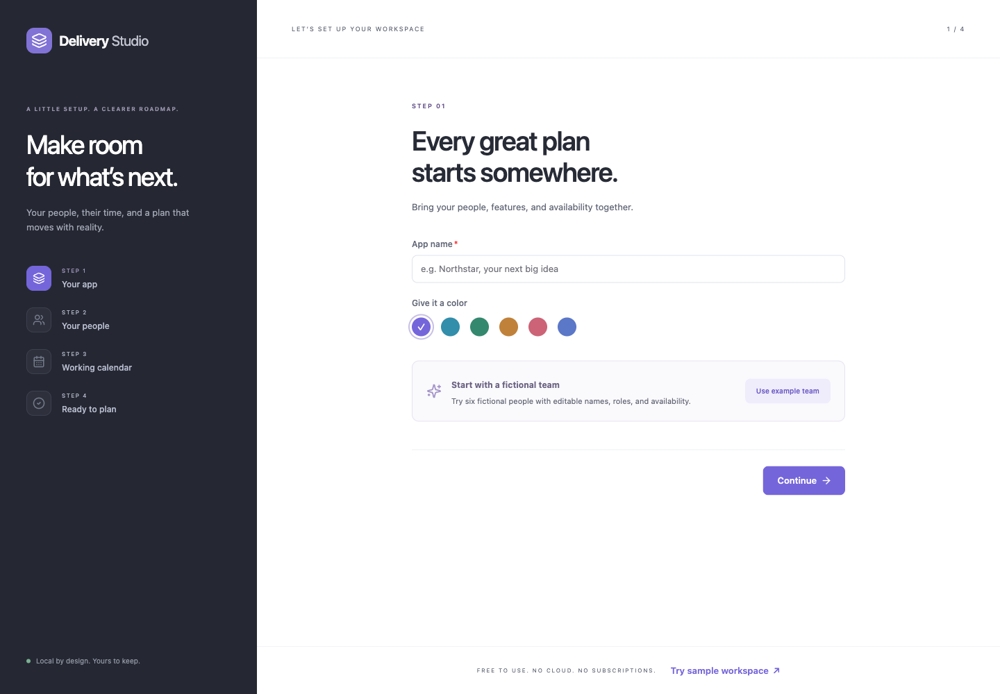

# Download and start Delivery Studio

Delivery Studio helps you visualize people, capacity, leave and delivery changes alongside your existing project-management tool. It runs locally in your browser. The portable download includes everything needed; you do not need Node.js, Git, or a terminal.

These are **unsigned beta downloads**. Mac builds are not notarized and Windows may warn about an unknown publisher. Only open a download you trust. Native Windows 10 and 11 execution is not yet verified.

## Choose your download

Open [Delivery Studio Releases](https://github.com/OBerbar/Delivery-Planner/releases), choose **v1.0.0-beta.1**, and expand **Assets**. Choose the application ZIP from this table. GitHub's automatic **Source code** ZIP is for installing from source; it is a different download.

| Computer                                              | Application ZIP                                |
| ----------------------------------------------------- | ---------------------------------------------- |
| Windows 10 or 11, 64-bit Intel/AMD                    | `Delivery-Studio-1.0.0-beta.1-windows-x64.zip` |
| Mac with Apple M1, M2, M3, M4, or other Apple silicon | `Delivery-Studio-1.0.0-beta.1-mac-arm64.zip`   |
| Mac with an Intel processor                           | `Delivery-Studio-1.0.0-beta.1-mac-x64.zip`     |

To check your Mac, open **Apple menu → About This Mac**: a **Chip** named Apple M… means Apple silicon; **Processor** Intel means Intel. These Mac packages require macOS 13.5 or later. For Windows, **Settings → System → About → System type** should show a 64-bit operating system with an x64 processor. Windows ARM computers are not a verified target of this beta.

The same release includes a source ZIP and SHA256SUMS.txt. The source, version tag and application downloads come from one committed revision. See [the changelog](../CHANGELOG.md) for changes.

**Testing status:** Apple silicon startup has been checked locally using the extracted package. Intel Mac execution, Windows 10/11 execution, and security prompts after a fresh download still need native checks. The screenshots below show the browser experience; operating-system prompts vary and are not pictured as verified steps.

## Windows: extract, then open

1. Download the Windows application ZIP.
2. Right-click it and choose **Extract All**. Choose a folder you can find again, such as Documents, and open the extracted **Delivery Studio** folder.
3. Double-click **Delivery Studio.exe**. Keep the **resources** folder alongside it. Do not run the EXE inside the ZIP or move it out on its own.
4. If Windows reports an unrecognized app, inspect the download source before proceeding. If you trust this release and the warning offers **More info → Run anyway**, that is the per-app option. If your computer blocks it by policy, ask its administrator; do not turn off system protection.
5. Your usual browser opens the planner at a local `127.0.0.1` address. Keep the application folder for reopening it later.

## Mac: extract, then open

1. Download the application ZIP matching your processor and double-click it to extract it.
2. Open the extracted **Delivery Studio** folder and move **Delivery Studio.app** to Applications or another permanent folder.
3. Double-click **Delivery Studio.app**. Your usual browser opens the local planner.
4. If macOS blocks the unsigned app, check the source first. After trying to open it, a trusted app may offer **System Settings → Privacy & Security → Open Anyway**, then a confirmation. Older macOS versions call this System Preferences / Security & Privacy. Follow [Apple's per-app instructions](https://support.apple.com/en-ie/102445); do not disable Gatekeeper. A damaged-app warning should be investigated, not bypassed.

## Your first delivery check

On a computer with no saved workspace, the browser opens the setup screen below. If you already have saved work, it opens your planner instead. Opening or updating the app does not replace it with an example.

For a guided example, choose **Try sample workspace** on this screen, or in **App settings**. It opens a separate tab with a fictional Northstar plan. Sample edits stay in memory and never save to your real workspace. See the [first-plan walkthrough](first-plan.md) for screenshots of people, leave, an urgent request, date comparison and export. From the sample banner, **First-plan walkthrough** also opens this guide inside the app; no internet connection is needed after downloading.

1. Name your app and add your people, or use the fictional example team.
2. Set the working calendar. Leave **Plan in sprints** off unless you want sprints, then review and open your planner.
3. Add a feature and select its people. Choose **Per person** to give one developer three working days and another seven. The timeline shows their separate bookings.
4. Add personal leave or apply a leave/holiday template to the relevant people. Review the forecast changes.
5. Enter **What-if planning**, add urgent work or change priority, and **Compare with saved plan**. Decide whether to apply or discard the experiment.

Read the [user manual](user-manual.md) for controls, estimates, leave templates, dates, backups and exports. A short planning conversation is the target; installation and entering your first team's data take additional time.

## Quit, back up, and update

Save or cancel any form and finish or discard a What-if experiment. Click **Quit Delivery Studio** at the bottom right and confirm. The browser shows **Delivery Studio stopped**. Close that tab. Closing a tab by itself does not quit the server; double-clicking the app while it is running reopens it.

Your workspace is saved outside the application folder:

- Mac: `~/Library/Application Support/DeliveryStudio`
- Windows: `%LOCALAPPDATA%\DeliveryStudio`

Use **App settings → Export full backup** to keep a backup somewhere safe. To update, quit first, extract the new ZIP into a new folder, and open the new application. It reads the same saved workspace on that computer. Keep a backup before trying a newer version; downgrading across a future database migration is not promised. To transfer from the source edition or another computer, use **Export full backup** and **Restore backup**. Restoring replaces the destination workspace after confirmation.

## If something does not open

Re-extract the entire ZIP and check the processor choice. Startup errors show a message; `delivery-studio.log` in the saved-data folder has details. If another launch is starting or stopping, wait a moment and try again. Restart your computer if it remains stuck. Do not delete the saved-data folder to fix startup: it contains your plans.

## Contributor checklist: test on Windows 10 and Windows 11

On each computer, record the OS version and test the actual downloaded/extracted ZIP using your normal account:

- Open the EXE without installing Node or using a terminal. Record any publisher warning and the exact browser behavior.
- Try an extracted folder whose name contains spaces and a non-English character. Keep EXE and resources together.
- Create a fictional app without sprints; save a feature and leave, reload, and confirm they remain.
- Open the EXE again while it is running: it should reopen the same workspace.
- Cancel the Quit confirmation; continue editing. Save, confirm Quit, and reopen: the saved workspace must remain.
- Quit, extract another copy into a new folder, and open it: the same saved workspace must remain.
- Export a backup and a timeline PDF. Restore a backup only into an isolated fictional workspace.
- Close the app, restart Windows, and open it again. Record any firewall prompt, security warning, crash, or lost value.

Capture the result before labelling the Windows download verified. The developer's optional automated lifecycle check is `release/smoke-download.mjs`; the manual checks above also cover Explorer, browser opening and OS security prompts.
