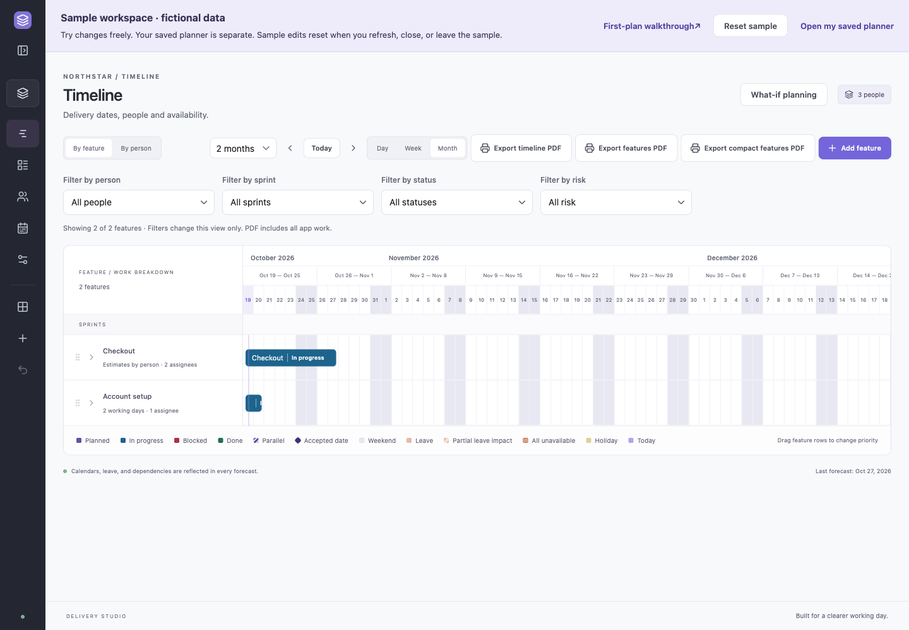
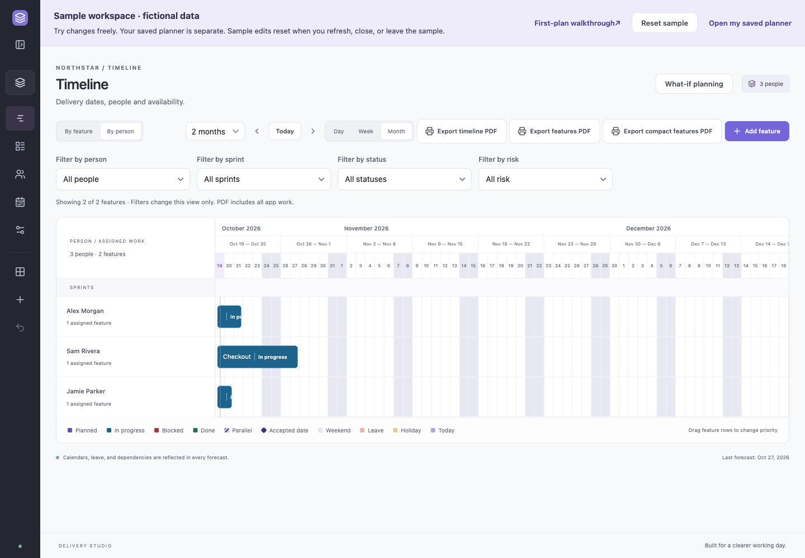
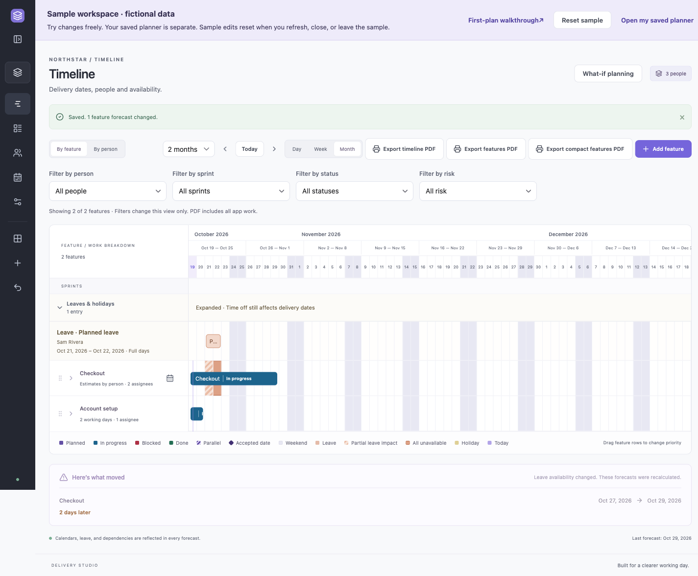
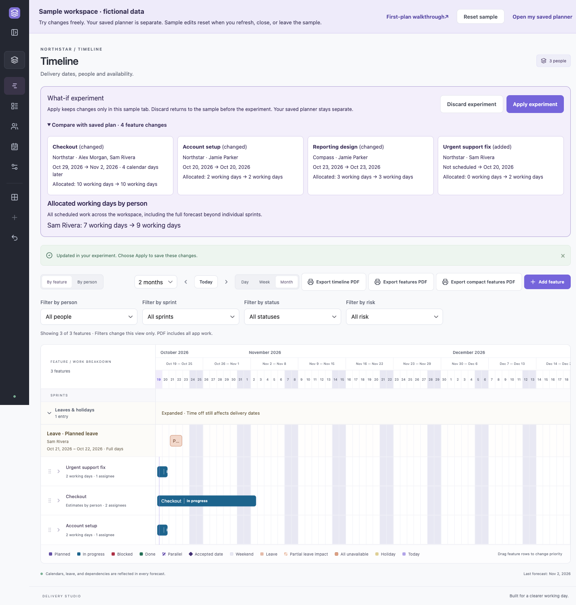
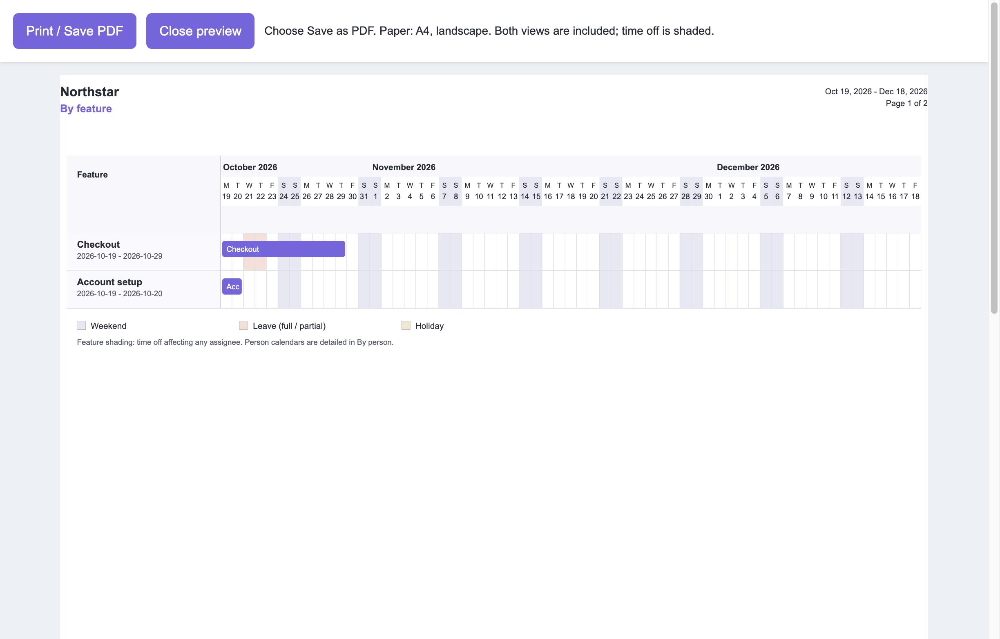

# Try your first delivery decision

See what happens to delivery when somebody takes leave or urgent work arrives. Start with the fictional **Northstar** sample; you do not need to enter your real team's details or configure sprints.

## 1. Open the sample safely

On the setup screen, choose **Try sample workspace**. If you already have a planner, open **App settings** and choose **Try sample workspace**. It opens a separate browser tab, leaving your planner and any open draft in their original tab.

Choose **First-plan walkthrough** in the sample banner to keep this guide open in another tab while you follow along. Look for **Sample workspace · fictional data** above the planner. All edits in that tab stay in memory. They do not read or save your real workspace. Refreshing, closing, or leaving the sample discards its edits. **Reset sample** asks for confirmation and starts the fictional example again. Cancel keeps your changes.

The sample begins around the day you open it. Screenshots below use 19 October 2026 so the example is reproducible; your dates will differ. Northstar uses Monday–Friday working days, eight hours a day, and no sprints. **Compass** is another fictional app sharing Jamie, the designer.

## 2. See each person's contribution

Choose **By person** on Timeline. Checkout has **three working days from Alex Morgan** and **seven from Sam Rivera**. Alex's bar ends first; Sam continues. These are ten person-days of effort, running in parallel. A shorter bar indicates potential unbooked capacity in this plan, not observed employee inactivity.

Click Checkout to inspect its **Per person** estimates, then **Cancel**. Jamie's **Account setup** and Compass's **Reporting design** share the same person's capacity; using the app picker does not create another Jamie.

## 3. Account for time off

Open **Team & leave → Add leave**. Choose **Sam Rivera**, set Leave starts and Leave ends to two upcoming working days inside Sam's Checkout booking, and optionally enter a note. Save, review **Review scheduling changes**, then choose **Save changes** if shown.

Return to Timeline. Sam's absence appears and Checkout's forecast moves. The impact panel shows the previous/new date and the change in **calendar days**. Working-day effort remains seven days for Sam. Use the actual dates displayed; weekends can make a two-working-day absence move a forecast by more than two calendar days.

For a reusable example, open **Team & leave → Reusable calendars**, choose **Example time off**, and apply it to selected people. Check its concrete dates first, especially if you opened the sample near a weekend. Creating a template alone does not apply time off. **Undo last change** reverses the latest sample save.

## 4. Try an urgent request before deciding

On Timeline, choose **What-if planning**, then **Add feature**. Enter **Urgent support fix**, select **Sam Rivera** as the main assignee, leave Same for everyone selected, and enter **2 Working days**. Choose **Save feature**.

Open **Compare with saved plan**. A new feature enters first in priority. Because it needs Sam too, Checkout may move. Compare the old/new dates and the displayed calendar-day delay. The comparison's “saved plan” is the current sample baseline in this tab, including any sample leave you applied; your personal planner remains separate.

Choose **Discard experiment** to return to the sample before the experiment. Or choose **Apply experiment** to keep it only in this sample tab. Applying here never saves to your real planner. For another experiment, give the urgent feature to Alex instead, compare the resulting dates, and check where Alex is already booked.

## 5. Share the example

Choose **Export timeline PDF**. A print preview opens in another tab; choose **Save as PDF** in your browser or operating system's print dialog. The export contains fictional sample data. During What-if, it is labelled as an experiment. Close the preview to continue.

## 6. Start your own plan

Keep your original planner tab open, or choose **Open my saved planner** in the sample banner. An existing workspace opens as saved; it is never replaced with Northstar. If no workspace exists yet, the normal setup wizard appears.

Name your app, add people, set working days and the planning start, then review. Leave **Plan in sprints** off unless you use sprints. Choose **Open my planner**, add your first feature and estimates, then add known time off. New apps can link existing people, so their availability remains shared.

In your real planner, changes save locally. Export a safety copy through **App settings → Export full backup**. Keep it somewhere safe, close/reopen the app, and confirm your records are there. **Restore backup** replaces the entire destination workspace after confirmation; it is not a way to add the sample to your planner.

For downloading, opening, quitting and updating, read [Download and installation](download-and-install.md). The detailed user manual accompanying the source download explains every field and the optional sprint workflows.
